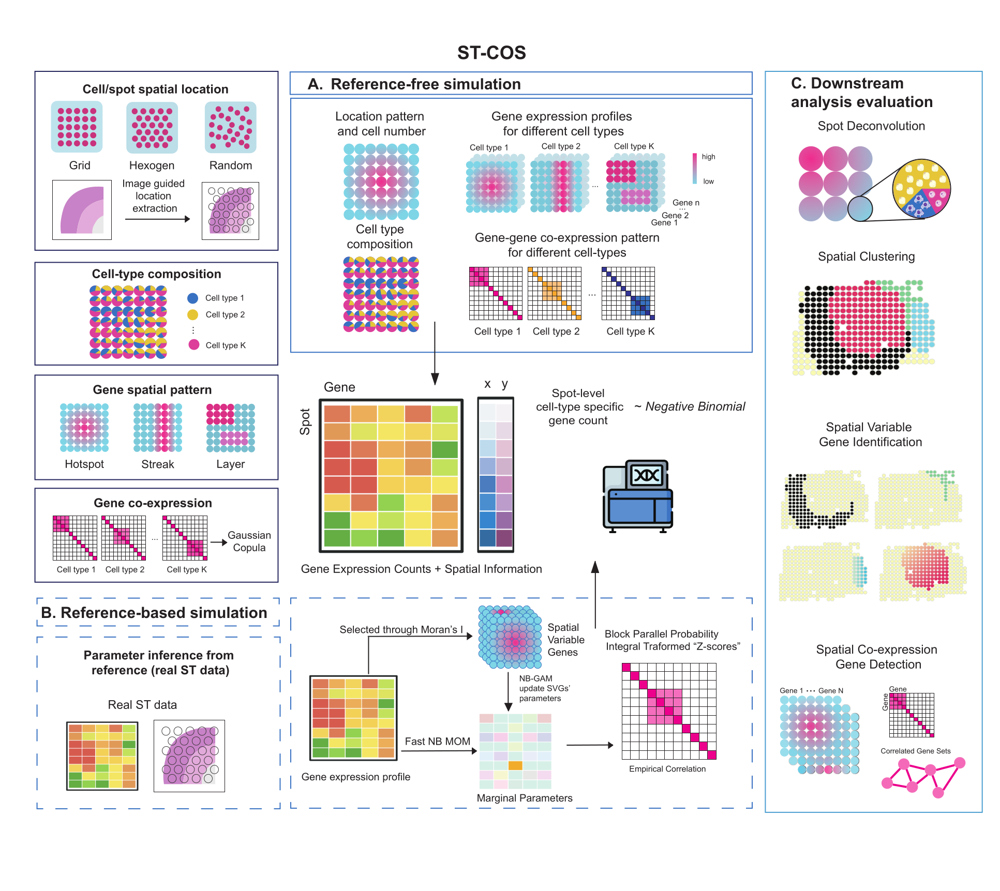

# ST-COS

**ST-COS** is an R package for simulating spatial transcriptomics data with
configurable spatial expression patterns, cell-type compositions,
negative-binomial marginals, and editable gene-gene dependence.

ST-COS supports three workflows:

- **Reference-free simulation:** design coordinates, cell-type composition,
  spatial gene patterns, and cell-type-specific latent correlation matrices.
- **Reference-based simulation:** estimate marginal, spatial, and global
  spot-level dependence parameters from an observed spatial transcriptomics
  dataset and generate new profiles from the fitted model.
- **Image-guided design:** place simulation coordinates on a histology image
  with the local coordinate designer, or configure a full reference-free
  simulation, including image segmentation, in the hosted Shiny application.



## Installation

Install the development version from GitHub:

```r
install.packages("devtools") # Skip if devtools is already installed
devtools::install_github("Yiyannnnn/ST-COS")
```

Then load the package:

```r
library(STCOS)
```

## Image-guided application

### Run locally from R

`stcos_shiny_app()` constructs a real Shiny application with
`shiny::shinyApp(ui, server)`. Run it from an R session with:

```r
app <- stcos_shiny_app()
shiny::runApp(app)
```

The local designer is a coordinate tool. It accepts a PNG or JPEG histology
image, uploaded coordinate tables (for example, centroids from an external
segmentation), image-click coordinates, and generated grid, hexagonal, or
random layouts. Generated layouts keep their aspect ratio when placed on the
image. With an image loaded, uploaded and clicked coordinates are read as
image pixels, and the exported CSV uses a y-up frame in pixel units, ready for
the reference-free workflow. The optional local interface uses the `shiny`,
`png`, and `jpeg` packages. Image segmentation, gene patterns, cell-type
composition, and dependence settings are provided by the hosted application.

### Open the hosted application

The hosted application additionally provides image segmentation, interactive
region selection, gene-pattern assignment, cell-type composition, and
gene-dependence controls. Open it from R with:

```r
launch_stcos_app()
```

On a headless system, retrieve the URL without trying to open a browser:

```r
launch_stcos_app(browser = FALSE)
```

The hosted application is also available directly at
[yiyanz.shinyapps.io/st-cos](https://yiyanz.shinyapps.io/st-cos/).

## Quick start

The example below creates two cell types, four genes, cell-type-specific
spatial patterns, and one correlated gene pair per cell type.

```r
library(STCOS)

set.seed(1)

# 1. Create spatial locations.
coord <- generate_coordinates(
  x_len = 10,
  y_len = 10,
  pattern = "grid",
  spot_distance = 1
)
rownames(coord) <- paste0("spot_", seq_len(nrow(coord)))

# 2. Assign a spatial mean pattern to each gene and cell type.
genes <- paste0("gene_", 1:4)
gene_pattern <- data.frame(
  Excitatory = c("hotspot", "hotspot", "no_pattern", "no_pattern"),
  Inhibitory = c("no_pattern", "no_pattern", "streak", "streak"),
  row.names = genes
)
mean_param <- generate_gene_pattern(coord, gene_pattern, seed = 1)

# 3. Define the genes participating in each dependence block.
gene_relationship <- data.frame(
  Excitatory = c(1, 1, NA, NA),
  Inhibitory = c(NA, NA, 1, 1),
  row.names = genes
)

# 4. Specify cell-type-specific latent correlation matrices.
rho <- array(
  0,
  dim = c(4, 4, 2),
  dimnames = list(genes, genes, c("Excitatory", "Inhibitory"))
)
diag(rho[, , "Excitatory"]) <- 1
diag(rho[, , "Inhibitory"]) <- 1
rho[1, 2, "Excitatory"] <- rho[2, 1, "Excitatory"] <- 0.6
rho[3, 4, "Inhibitory"] <- rho[4, 3, "Inhibitory"] <- 0.6

# 5. Generate one spot-level expression profile for each cell type.
cell_type_profiles <- generate_true_count(
  coord = coord,
  mean_param = mean_param,
  gene_relationship = gene_relationship,
  cov_gene = rho,
  theta_g = list(
    Excitatory = rep(10, 4),
    Inhibitory = rep(10, 4)
  )
)

# 6. Mix the cell-type profiles using spatially varying abundances.
p_excitatory <- plogis((coord$x_coord - 5) / 1.5)
celltype_proportion <- cbind(
  Excitatory = p_excitatory,
  Inhibitory = 1 - p_excitatory
)
rownames(celltype_proportion) <- rownames(coord)

spot_expression <- generate_spot_count(
  true_count = cell_type_profiles,
  nGenes = length(genes),
  cell_number = 8,
  celltype_proportion = celltype_proportion
)

dim(spot_expression)
spot_expression[1:4, ]
```

## Cell-resolved data

For cell-resolved or subcellular layouts, simulate each cell type at its own
coordinates and combine the profiles without abundance mixing (equivalent to
one cell per location):

```r
library(STCOS)

set.seed(2)
cells <- generate_coordinates(x_len = 20, y_len = 20, pattern = "random",
                              n_spot = 300)
cells$cell_type <- ifelse(cells$x_coord < 10, "Excitatory", "Inhibitory")
genes <- paste0("gene_", 1:4)

cell_profiles <- lapply(split(cells, cells$cell_type), function(cc) {
  ct <- cc$cell_type[1]
  pattern <- data.frame(c("hotspot", "hotspot", "no_pattern", "no_pattern"),
                        row.names = genes)
  names(pattern) <- ct
  means <- generate_gene_pattern(cc, pattern)
  rho <- diag(4)
  rho[1, 2] <- rho[2, 1] <- 0.5
  relationship <- data.frame(c(1, 1, NA, NA), row.names = genes)
  names(relationship) <- ct
  counts <- generate_true_count(
    coord = cc, mean_param = means, gene_relationship = relationship,
    cov_gene = rho, theta_g = setNames(list(rep(5, 4)), ct)
  )[[ct]]
  cbind(cc, counts)
})
cell_expression <- do.call(rbind, cell_profiles)
head(cell_expression)
```

## Reference-based simulation

For an observed count matrix with genes in rows and spots in columns, estimate
the reference-based parameters with `get_real_param()`:

```r
# expr: genes x spots count matrix
# spatial_coord: data frame with columns named "row" and "col"
fitted <- get_real_param(
  expr = expr,
  coord = spatial_coord,
  gene_names = rownames(expr),
  n_cores = 4
)

simulated <- generate_true_count(
  coord = spatial_coord,
  mean_param = fitted$mean_param,
  gene_relationship = fitted$gene_relationship,
  cov_gene = fitted$cov_gene,
  theta_g = fitted$theta_g,
  library_size = fitted$library_size
)
```

The reference-based workflow estimates one global spot-level dependence
matrix. Cell-type-specific dependence matrices must be supplied externally or
specified through the reference-free workflow.

## Input conventions

| Object | Expected structure |
| --- | --- |
| Reference counts | Genes in rows and spots in columns |
| Reference coordinates | One row per spot, with columns `row` and `col` |
| Reference-free coordinates | One row per spot, with columns `x_coord` and `y_coord` |
| Mean parameters | Named list of spot-by-gene matrices, one per cell type |
| Cell-type proportions | Spot-by-cell-type matrix; every row must sum to one |
| Dependence parameters | Gene-by-gene matrix or array containing one matrix per cell type |


## Documentation and support

- [Full tutorial](https://yiyannnnn.github.io/STCOS_tutorial/)
- [Tutorial source](https://github.com/Yiyannnnn/STCOS_tutorial)
- [Main-figure reproducibility code](reproducibility/README.md) (Figures 2-4)
- [Report a problem or request a feature](https://github.com/Yiyannnnn/ST-COS/issues)
- In R, run `help(package = "STCOS")` or `?generate_true_count` for function
  documentation.

## License

ST-COS is released under the [MIT License](LICENSE).
